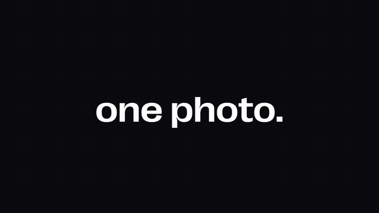
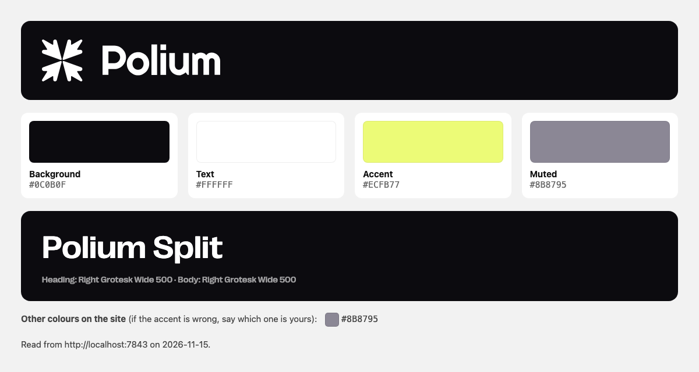
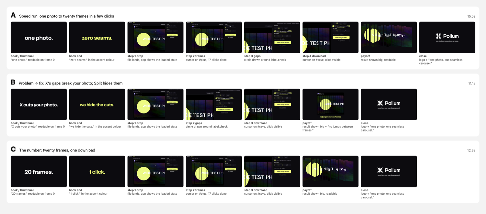
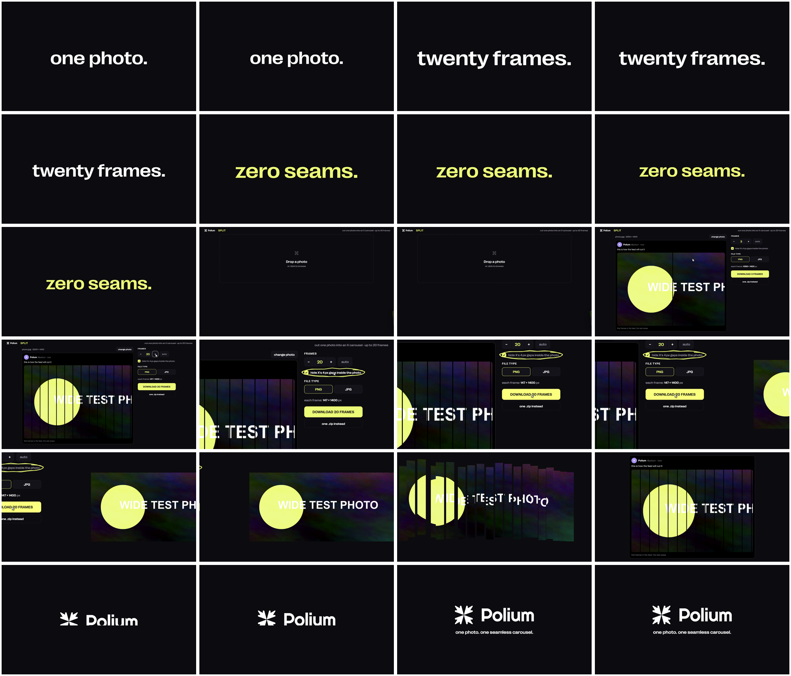

# demo-video

**Product demo videos for any brand, made by talking to Claude.** It drives your real product and reads your real brand. You pick a concept, approve the script, and get a finished video that has passed automated checks. Nothing is invented: no fake UI, no made-up claims, no stand-in logo.



*A 15-second launch demo of [Polium Split](examples/polium-split/), made with this repo. Every screen is a capture of the real app.*

---

## Use it

Install it as a Claude Code skill:

```bash
git clone https://github.com/poliumpk-lgtm/demo-video ~/.claude/skills/demo-video
```

Then, in any project, say:

> make me a demo video for my product

You can also paste this repo's link into Claude Code (or any agent that can run commands) and ask what to do. Claude handles the setup itself; you never need a terminal.

## What happens

**1. Three questions, one at a time.** What are we demoing (a link, localhost or your repo)? Do you have a brand guide, or just a website? Where will it run, and what's the one thing people should remember?

**2. Your brand, read from the source.** Give it your website and it reads the colours, fonts and logo your site actually uses. It shows a brand card and asks "Is this you?" Corrections are plain words ("the green is darker").



**3. Claude explores your product.** It clicks through it, finds the impressive moment, and checks with you: "Here's the flow I found. Right?"

**4. You pick a concept instead of writing a script.** Three concepts, each a different angle, shown as storyboards of your own product. Pick one or mix them. Claude writes the frame-by-frame script and asks only for what it can't know (closing line, link, music). Nothing is built until you say yes.



**5. Draft, review, deliver.** You get the video and a contact sheet of every key moment. Give notes like you would to an editor ("the zoom is too fast"); each round takes minutes. The final file comes in your platform's shape, with post copy in your voice.

## Why it holds up

- **Real screens.** It drives your actual app and captures every state in high resolution. The cursor clicks where the real button is, not "about there".
- **Honest by rule.** No features your product doesn't have, and no claims you didn't make. Any number on screen comes from your real file. You pick the music.
- **Checked by measurement, not by eye.** Every video passes QA:
  - frame 0 works as a thumbnail;
  - every frame renders the same every time;
  - your brand colour is really on screen;
  - the file is right (size, frame rate, audio sync).



## Requirements

- Node 18+ and ffmpeg. The setup script checks both and installs the rest (Remotion, Playwright, browsers).
- **Web apps** are captured automatically. **Mobile and desktop apps** work from a screen recording ([how](references/onboarding.md)).
- Apps behind a login: you sign in yourself in a browser window it opens, and your password never passes through the chat.

## How it's built

```
SKILL.md        the flow Claude follows: onboarding, concepts, rules
references/     onboarding · concepts & script rules · file formats · QA · effects · custom payoffs
scripts/        doctor · new · brand · explore · login · capture · storyboard · render · qa
engine/         one shared Remotion project that renders any project folder
examples/       a worked example (Polium Split)
```

Each video is a plain folder: `brand.json`, `flow.json` (the app, the steps, the hook, the payoff), the captures, and a `brief.md` with the facts, the approved script and every correction. One engine renders any folder, so a second video for the same product starts at the concept step.

<details>
<summary>Run it by hand</summary>

```bash
node scripts/doctor.mjs                                   # setup
node scripts/new.mjs demos/acme --url http://localhost:3000
node scripts/brand.mjs https://acme.com demos/acme        # brand.json + brand card
node scripts/explore.mjs http://localhost:3000 --out demos/acme/explore
# write demos/acme/flow.json (and concepts/A.json, B.json, C.json)
node scripts/capture.mjs demos/acme                       # real screens
node scripts/storyboard.mjs demos/acme                    # concept board
node scripts/render.mjs demos/acme --beats                # stills
node scripts/render.mjs demos/acme                        # video
node scripts/qa.mjs demos/acme --video out/demo.mp4       # checks
```

File formats: [references/flow-format.md](references/flow-format.md). Effects: [references/effects.md](references/effects.md). Your own payoff move: [references/custom-payoffs.md](references/custom-payoffs.md).
</details>

## License and credits

The code is MIT ([LICENSE](LICENSE)). It renders with [Remotion](https://remotion.dev), which has its own license: free for individuals and small teams, while larger companies need a Remotion company license. Check [remotion.dev/license](https://remotion.dev/license).

The method draws on two articles about motion work with AI: one on turning references into rules (beamnxw), and one on the ways AI-made video goes wrong and how to check for them (m4lkxx). The effects rebuild looks popularised by Rough Notation, Splitting, Typed.js, vanilla-tilt and others as frame-driven Remotion components; no code was copied. The X feed layout numbers in the Polium Split example come from [winchxyz/pasteup](https://github.com/winchxyz/pasteup) (MIT).

Brands, logos and fonts belong to their owners. The tool uses your own brand files for your own videos, and none are bundled.

Made by [Polium](https://polium.co).
